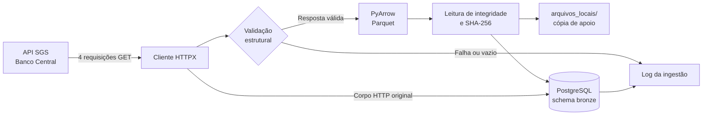

# Pipeline de Indicadores Econômicos Brasileiros

[](https://www.python.org/)
[](https://www.postgresql.org/)
[](#arquitetura)
[](#resultado-validado)

Projeto final da **Trilha Júnior do Emprega Dados** para ingestão, preservação e rastreabilidade de indicadores econômicos publicados pelo Banco Central do Brasil.

Nesta primeira etapa, o pipeline consulta quatro séries do SGS, preserva os dados recebidos sem transformações de negócio, gera arquivos Parquet e mantém o histórico de cada execução em um banco PostgreSQL local.

## Sumário

- [Objetivo](#objetivo)
- [Indicadores coletados](#indicadores-coletados)
- [Arquitetura](#arquitetura)
- [Regras da camada Bronze](#regras-da-camada-bronze)
- [Estrutura do projeto](#estrutura-do-projeto)
- [Tecnologias](#tecnologias)
- [Como executar](#como-executar)
- [Persistência e auditoria](#persistência-e-auditoria)
- [Testes](#testes)
- [Resultado validado](#resultado-validado)
- [Segurança](#segurança)
- [Próximas etapas](#próximas-etapas)

## Objetivo

Construir uma camada Bronze auditável para dados econômicos, garantindo:

- no máximo quatro requisições HTTP por execução;
- preservação dos campos `data` e `valor` como strings;
- armazenamento em Parquet sem deduplicação ou conversão de tipos;
- persistência do arquivo, JSON estruturado e corpo HTTP original;
- identificação de cada execução por UUID;
- validação de integridade e hash SHA-256 dos arquivos;
- histórico completo, sem sobrescrever cargas anteriores;
- isolamento de falhas entre os indicadores;
- registro de sucesso, ausência de dados e falhas.

A implementação segue a [SPEC 001 — Camada Bronze](specs/SPEC_001_BRONZE.md).

## Indicadores coletados

| Indicador | Código SGS | Periodicidade | Diretório local |
|---|---:|---|---|
| Meta Selic | `432` | Diária | `selic/` |
| IPCA | `433` | Mensal | `ipca/` |
| Dólar americano — venda | `1` | Diária | `dolar/` |
| CDI anualizado | `4389` | Diária | `cdi/` |

- **Fonte:** API SGS do Banco Central do Brasil.
- **Data inicial:** `01/01/2023`.
- **Data final:** calculada no momento da execução.
- **Autenticação na API:** não requerida.
- **Formato de origem:** JSON.

## Arquitetura

O projeto utiliza a arquitetura Medallion. A SPEC atual implementa exclusivamente a camada Bronze; as camadas Prata e Ouro fazem parte da evolução planejada.



### Fluxo de uma execução

1. Carrega as configurações do `.env`.
2. Valida ou cria o database `db_emp_dados_junior`.
3. Cria o schema e as tabelas Bronze quando necessário.
4. Gera um UUID para identificar a execução.
5. Consulta cada indicador uma única vez, sem retries automáticos.
6. Valida a estrutura JSON recebida.
7. Serializa `data` e `valor` como strings em Parquet.
8. Relê o Parquet e calcula seu SHA-256.
9. Mantém uma cópia local e persiste o conteúdo no PostgreSQL.
10. Registra o resultado individual de cada indicador.

## Regras da camada Bronze

Na camada Bronze os dados são preservados como publicados pela fonte. Portanto, o pipeline não realiza:

- conversão de datas;
- conversão de valores para tipos numéricos;
- remoção de duplicidades;
- tratamento de valores nulos;
- agregações;
- cálculos econômicos;
- regras de negócio.

Essas responsabilidades pertencem às próximas camadas da arquitetura.

## Estrutura do projeto

```text
.
├── .env.example
├── .gitignore
├── pytest.ini
├── README.md
├── requirements.txt
│
├── arquivos_locais/              # Ignorado pelo Git
│   ├── .venv/                    # Ambiente virtual recomendado
│   ├── data/
│   │   └── bronze/
│   │       └── banco_central/
│   │           ├── selic/
│   │           ├── ipca/
│   │           ├── dolar/
│   │           └── cdi/
│   └── logs/
│
├── specs/
│   └── SPEC_001_BRONZE.md
│
├── src/
│   ├── config/                   # Leitura e validação do .env
│   ├── database/                 # PostgreSQL e repositórios
│   ├── ingestion/                # Cliente BCB, Parquet e orquestração
│   ├── utils/                    # Configuração de logs
│   └── models.py                 # Modelos compartilhados
│
└── tests/
    ├── test_bcb_client.py
    └── test_parquet.py
```

## Tecnologias

| Tecnologia | Responsabilidade |
|---|---|
| Python | Implementação do pipeline |
| HTTPX | Consumo da API SGS sem retries automáticos |
| PyArrow | Escrita e validação dos arquivos Parquet |
| Psycopg 3 | Comunicação transacional com PostgreSQL |
| PostgreSQL | Persistência definitiva da camada Bronze |
| python-dotenv | Carregamento seguro das configurações locais |
| Pytest | Testes automatizados |
| Logging | Logs locais de execução e falhas |

> A SPEC recomenda Python 3.11 ou superior. A implementação também foi validada localmente com Python 3.10.11.

## Como executar

### Pré-requisitos

- Python instalado;
- PostgreSQL em execução;
- Git;
- usuário PostgreSQL com permissão para criar o database na primeira execução.

### 1. Clonar o repositório

```powershell
git clone https://github.com/aamartins86/emp_dados_01_desafio_final_pipeline.git
cd emp_dados_01_desafio_final_pipeline
```

### 2. Criar e ativar o ambiente virtual

O ambiente fica em `arquivos_locais/`, mantendo todos os artefatos locais centralizados em uma única pasta ignorada pelo Git.

```powershell
python -m venv arquivos_locais/.venv
.\arquivos_locais\.venv\Scripts\Activate.ps1
python -m pip install --upgrade pip
python -m pip install -r requirements.txt
```

### 3. Configurar as variáveis de ambiente

```powershell
Copy-Item .env.example .env
```

Preencha o `.env` com as credenciais locais:

```dotenv
DB_HOST=localhost
DB_PORT=5432
DB_NAME=db_emp_dados_junior
DB_SCHEMA=bronze
DB_USER=seu_usuario
DB_PASSWORD=sua_senha

DATA_BRONZE_PATH=arquivos_locais/data/bronze
LOG_LEVEL=INFO
LOG_DIR=arquivos_locais/logs
HTTP_TIMEOUT_SECONDS=30
```

### 4. Executar os testes

O parâmetro `-B` impede a geração de diretórios `__pycache__` fora de `arquivos_locais/`.

```powershell
python -B -m pytest -q
```

### 5. Executar a ingestão

```powershell
python -B -m src.ingestion.pipeline
```

O pipeline tenta criar o database na primeira execução. Se `db_emp_dados_junior` já existir, o usuário precisa somente de acesso ao database e permissão para criar e gravar no schema configurado.

## Persistência e auditoria

### `bronze.tb_arquivos_parquet`

Armazena uma linha por indicador e execução, contendo:

- UUID da execução;
- nome e código SGS do indicador;
- nome e conteúdo binário do Parquet (`BYTEA`);
- JSON estruturado (`JSONB`);
- corpo HTTP original (`BYTEA`);
- intervalo consultado;
- quantidade de registros;
- hash SHA-256;
- data e hora da ingestão.

### `bronze.tb_log_ingestao`

Registra cada tentativa com um dos status:

| Status | Significado |
|---|---|
| `SUCESSO` | Parquet validado e persistido |
| `SEM_DADOS` | API respondeu sem observações |
| `FALHA` | Erro HTTP, JSON, Parquet ou persistência |

### Consultas úteis

Arquivos ingeridos por execução:

```sql
SELECT
    id_execucao,
    indicador,
    codigo_sgs,
    quantidade_registros,
    hash_arquivo,
    data_ingestao
FROM bronze.tb_arquivos_parquet
ORDER BY data_ingestao DESC;
```

Resultado das tentativas:

```sql
SELECT
    id_execucao,
    indicador,
    status_http,
    status_ingestao,
    quantidade_registros,
    mensagem_erro
FROM bronze.tb_log_ingestao
ORDER BY data_inicio_execucao DESC;
```

## Testes

A suíte atual verifica:

- configuração exata dos quatro códigos SGS;
- uma única requisição HTTP por indicador;
- preservação do corpo JSON original;
- manutenção de `data` e `valor` como strings;
- geração, leitura e integridade do Parquet;
- geração do hash SHA-256.

```text
3 passed
```

## Resultado validado

Execução de referência realizada em **07/11/2026**, identificada pelo UUID `04bc3676-3e3c-437f-89d2-33d2a2b87ba8`:

| Indicador | Registros | HTTP | Persistência |
|---|---:|---:|---|
| Meta Selic | 1.407 | 200 | Sucesso |
| IPCA | 45 | 200 | Sucesso |
| Dólar americano — venda | 966 | 200 | Sucesso |
| CDI anualizado | 965 | 200 | Sucesso |

Os quatro Parquets foram relidos com sucesso, tiveram hashes SHA-256 válidos e foram persistidos junto aos respectivos metadados e corpos JSON originais.

## Segurança

- O `.env` permanece somente na máquina local.
- Credenciais não são inseridas no código ou em logs.
- `.env.example` contém apenas valores ilustrativos.
- `arquivos_locais/` concentra ambiente virtual, Parquets e logs e não é versionada.
- Identificadores SQL dinâmicos são tratados com `psycopg.sql.Identifier`.
- Arquivo e log de sucesso são persistidos na mesma transação.

O `.gitignore` mantém fora do repositório:

```gitignore
.env
arquivos_locais/
```

## Próximas etapas

- [x] Camada Bronze: ingestão e preservação dos dados brutos.
- [x] Persistência de Parquet, JSON e corpo HTTP no PostgreSQL.
- [x] Logs, UUID, hash e histórico de execuções.
- [x] Testes unitários da API e do Parquet.
- [ ] Camada Prata: tipagem, padronização e qualidade dos dados.
- [ ] Camada Ouro: indicadores analíticos e modelagem para consumo.
- [ ] Testes de integração automatizados com PostgreSQL.
- [ ] Integração contínua no GitHub Actions.

## Autor

Desenvolvido por [Adriano Martins](https://github.com/aamartins86) como projeto da Trilha Júnior do Emprega Dados.
