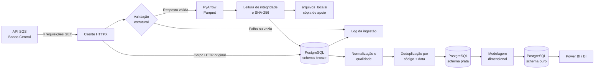
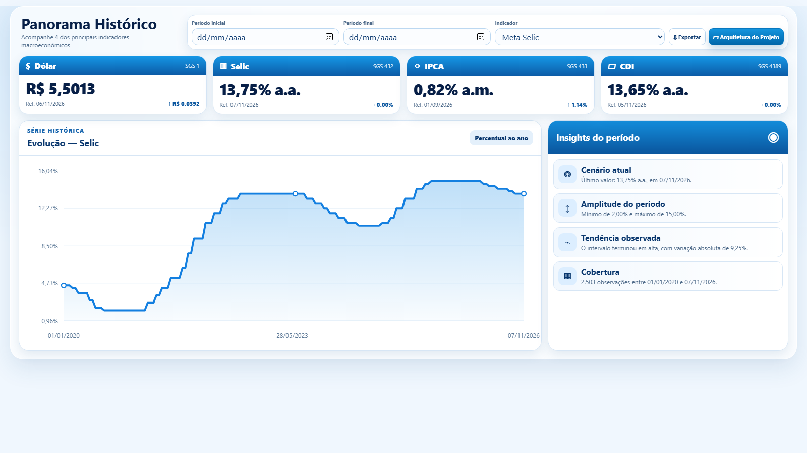
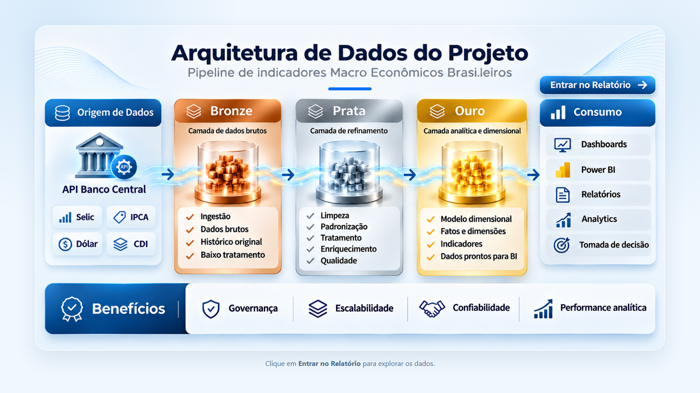

# Pipeline de Indicadores Econômicos Brasileiros

[](https://www.python.org/)
[](https://www.postgresql.org/)
[](#arquitetura)
[](#resultado-validado)

Projeto final da **Trilha Júnior do Emprega Dados** para ingestão, preservação e rastreabilidade de indicadores econômicos publicados pelo Banco Central do Brasil.

> **Relatório público:** [acessar o Portal de Indicadores Macroeconômicos](https://aamartins86.github.io/emp_dados_01_desafio_final_pipeline/#insights)

O pipeline consulta quatro séries do SGS, preserva os dados brutos em Parquet e PostgreSQL, normaliza as observações na camada Prata e disponibiliza um modelo estrela na camada Ouro para consumo analítico.

## Sumário

- [Objetivo](#objetivo)
- [Indicadores coletados](#indicadores-coletados)
- [Arquitetura](#arquitetura)
- [Regras da camada Bronze](#regras-da-camada-bronze)
- [Camada Prata](#camada-prata)
- [Camada Ouro](#camada-ouro)
- [Estrutura do projeto](#estrutura-do-projeto)
- [Tecnologias](#tecnologias)
- [Como executar](#como-executar)
- [Portal analítico](#portal-analítico)
- [Persistência e auditoria](#persistência-e-auditoria)
- [Testes](#testes)
- [Resultado validado](#resultado-validado)
- [Segurança](#segurança)
- [Próximas etapas](#próximas-etapas)

## Objetivo

Construir uma camada Bronze auditável para dados econômicos, garantindo:

- no máximo quatro requisições HTTP por execução;
- preservação dos campos `data` e `valor` como strings;
- armazenamento em Parquet sem deduplicação ou conversão de tipos;
- persistência do arquivo, JSON estruturado e corpo HTTP original;
- identificação de cada execução por UUID;
- validação de integridade e hash SHA-256 dos arquivos;
- histórico completo, sem sobrescrever cargas anteriores;
- isolamento de falhas entre os indicadores;
- registro de sucesso, ausência de dados e falhas.

A implementação de dados segue a [SPEC 001 — Camada Bronze](specs/SPEC_001_BRONZE.md), a [SPEC 002 — Camada Prata](specs/SPEC_002_PRATA.md) e a [SPEC 003 — Camada Ouro](specs/SPEC_003_OURO.md). O portal para consumo analítico está definido na [SPEC 004 — Portal Analítico](specs/SPEC_004_PORTAL_ANALITICO.md).

## Indicadores coletados

| Indicador | Código SGS | Periodicidade | Diretório local |
|---|---:|---|---|
| Meta Selic | `432` | Diária | `selic/` |
| IPCA | `433` | Mensal | `ipca/` |
| Dólar americano — venda | `1` | Diária | `dolar/` |
| CDI anualizado | `4389` | Diária | `cdi/` |

- **Fonte:** API SGS do Banco Central do Brasil.
- **Data inicial:** `01/01/2020`.
- **Data final:** calculada no momento da execução.
- **Autenticação na API:** não requerida.
- **Formato de origem:** JSON.

## Arquitetura

O projeto utiliza a arquitetura Medallion com as três camadas implementadas.



### Fluxo de uma execução

1. Carrega as configurações do `.env`.
2. Valida ou cria o database `db_emp_dados_junior`.
3. Cria o schema e as tabelas Bronze quando necessário.
4. Gera um UUID para identificar a execução.
5. Consulta cada indicador uma única vez, sem retries automáticos.
6. Valida a estrutura JSON recebida.
7. Serializa `data` e `valor` como strings em Parquet.
8. Relê o Parquet e calcula seu SHA-256.
9. Mantém uma cópia local e persiste o conteúdo no PostgreSQL.
10. Registra o resultado individual de cada indicador.

## Regras da camada Bronze

Na camada Bronze os dados são preservados como publicados pela fonte. Portanto, o pipeline não realiza:

- conversão de datas;
- conversão de valores para tipos numéricos;
- remoção de duplicidades;
- tratamento de valores nulos;
- agregações;
- cálculos econômicos;
- regras de negócio.

Essas responsabilidades pertencem às próximas camadas da arquitetura.

## Camada Prata

A transformação lê exclusivamente os Parquets armazenados na Bronze e não realiza novas chamadas ao Banco Central. Os registros aprovados são convertidos para:

- `data_referencia DATE`;
- `valor NUMERIC(20,8)`;
- código e dimensão do indicador;
- execução, arquivo, data de ingestão e posição de origem.

A chave natural é `(codigo_sgs, data_referencia)`. Quando existem várias versões, vence a observação da ingestão mais recente; valores alterados geram histórico e dados inválidos são registrados com o motivo da rejeição.

O modo incremental controla cada arquivo pelo identificador e SHA-256. O modo completo relê todo o histórico Bronze e reaplica as mesmas regras de forma determinística.

## Camada Ouro

A carga Ouro lê somente os dados consolidados da Prata e cria um modelo estrela composto por:

| Tabela | Tipo | Finalidade |
|---|---|---|
| `ouro.dim_calendario` | Dimensão | Datas contínuas desde 01/01/2020, com atributos em português |
| `ouro.dim_indicador` | Dimensão | Cadastro SCD Tipo 1 dos indicadores |
| `ouro.fct_indicadores_economicos` | Fato | Uma observação por indicador e data |

A fato utiliza chaves estrangeiras para as duas dimensões e unicidade em `(id_indicador, id_data)`. A reconciliação usa UPSERT, preserva as chaves substitutas e reflete novos valores ou alterações da Prata sem usar `TRUNCATE`.

## Estrutura do projeto

```text
.
├── .env.example
├── .gitignore
├── pytest.ini
├── README.md
├── requirements.txt
│
├── arquivos_locais/              # Ignorado pelo Git
│   ├── .venv/                    # Ambiente virtual recomendado
│   ├── data/
│   │   └── bronze/
│   │       └── banco_central/
│   │           ├── selic/
│   │           ├── ipca/
│   │           ├── dolar/
│   │           └── cdi/
│   └── logs/
│
├── specs/
│   ├── SPEC_001_BRONZE.md
│   ├── SPEC_002_PRATA.md
│   ├── SPEC_003_OURO.md
│   └── SPEC_004_PORTAL_ANALITICO.md
│
├── docs/
│   └── images/                   # Capturas da versão pública
│
├── dist/                         # Portal estático e snapshot público da Ouro
│
├── src/
│   ├── config/                   # Leitura e validação do .env
│   ├── database/                 # PostgreSQL e repositórios
│   ├── ingestion/                # Cliente BCB, Parquet e orquestração
│   ├── transformation/           # Normalização, qualidade e deduplicação
│   ├── analytics/                # Modelo estrela e pipeline Ouro
│   ├── web/                      # API local, frontend e exportação estática
│   ├── utils/                    # Configuração de logs
│   └── models.py                 # Modelos compartilhados
│
└── tests/
    ├── test_bcb_client.py
    ├── test_parquet.py
    ├── test_silver_normalizer.py
    ├── test_silver_deduplication.py
    ├── test_gold_calendar.py
    └── test_web_server.py
```

## Tecnologias

| Tecnologia | Responsabilidade |
|---|---|
| Python | Implementação do pipeline |
| HTTPX | Consumo da API SGS sem retries automáticos |
| PyArrow | Escrita e validação dos arquivos Parquet |
| Psycopg 3 | Comunicação transacional com PostgreSQL |
| PostgreSQL | Persistência definitiva da camada Bronze |
| python-dotenv | Carregamento seguro das configurações locais |
| Pytest | Testes automatizados |
| Logging | Logs locais de execução e falhas |

> A SPEC recomenda Python 3.11 ou superior. A implementação também foi validada localmente com Python 3.10.11.

## Como executar

### Pré-requisitos

- Python instalado;
- PostgreSQL em execução;
- Git;
- usuário PostgreSQL com permissão para criar o database na primeira execução.

### 1. Clonar o repositório

```powershell
git clone https://github.com/aamartins86/emp_dados_01_desafio_final_pipeline.git
cd emp_dados_01_desafio_final_pipeline
```

### 2. Criar e ativar o ambiente virtual

O ambiente fica em `arquivos_locais/`, mantendo todos os artefatos locais centralizados em uma única pasta ignorada pelo Git.

```powershell
python -m venv arquivos_locais/.venv
.\arquivos_locais\.venv\Scripts\Activate.ps1
python -m pip install --upgrade pip
python -m pip install -r requirements.txt
```

### 3. Configurar as variáveis de ambiente

```powershell
Copy-Item .env.example .env
```

Preencha o `.env` com as credenciais locais:

```dotenv
DB_HOST=localhost
DB_PORT=5432
DB_NAME=db_emp_dados_junior
DB_SCHEMA=bronze
DB_SCHEMA_PRATA=prata
DB_SCHEMA_OURO=ouro
DB_USER=seu_usuario
DB_PASSWORD=sua_senha

DATA_BRONZE_PATH=arquivos_locais/data/bronze
LOG_LEVEL=INFO
LOG_DIR=arquivos_locais/logs
HTTP_TIMEOUT_SECONDS=30
```

### 4. Executar os testes

O parâmetro `-B` impede a geração de diretórios `__pycache__` fora de `arquivos_locais/`.

```powershell
python -B -m pytest -q
```

### 5. Executar a ingestão

```powershell
python -B -m src.ingestion.pipeline
```

O pipeline tenta criar o database na primeira execução. Se `db_emp_dados_junior` já existir, o usuário precisa somente de acesso ao database e permissão para criar e gravar no schema configurado.

### 6. Executar a transformação Prata

Modo incremental, utilizado normalmente:

```powershell
python -B -m src.transformation.pipeline
```

Reprocessamento completo de todos os arquivos Bronze:

```powershell
python -B -m src.transformation.pipeline --full
```

### 7. Executar a carga Ouro

```powershell
python -B -m src.analytics.pipeline
```

A carga sempre reconcilia a Ouro com a Prata por UPSERT. Como o volume é reduzido, não é necessária uma tabela técnica de controle no schema analítico.

### 8. Executar o portal analítico

Com o PostgreSQL em execução e a camada Ouro carregada:

```powershell
python -B -m src.web.server
```

Abra no navegador:

```text
http://127.0.0.1:8000
```

O servidor utiliza as credenciais do `.env` somente no backend. O navegador
recebe apenas os dados analíticos necessários e não acessa diretamente o
PostgreSQL.

Para gerar a versão estática utilizada na publicação pública:

```powershell
python -B -m src.web.export_static
```

O comando exporta para `dist/` somente os arquivos do portal e um snapshot JSON
da camada Ouro. Credenciais, `.env`, Parquets e logs não são incluídos.

## Portal analítico

**Acesso público:** [Indicadores Macroeconômicos Brasileiros](https://aamartins86.github.io/emp_dados_01_desafio_final_pipeline/#insights)

O portal implementa a [SPEC 004](specs/SPEC_004_PORTAL_ANALITICO.md) e contém:

- página Projeto com a arquitetura aprovada;
- acesso ao relatório pelo botão `Entrar no Relatório`;
- aba `Relatório` com cabeçalho e filtros compactos para notebook;
- KPIs reais de Selic, IPCA, Dólar e CDI;
- filtros por indicador e período;
- gráfico histórico e insights determinísticos;
- exportação CSV;
- navegação simplificada entre Relatório e Arquitetura do Projeto;
- layout responsivo para desktop, tablet e celular.

As consultas utilizam exclusivamente as três tabelas do schema `ouro`.

### Relatório



### Arquitetura do projeto



## Persistência e auditoria

### `bronze.tb_arquivos_parquet`

Armazena uma linha por indicador e execução, contendo:

- UUID da execução;
- nome e código SGS do indicador;
- nome e conteúdo binário do Parquet (`BYTEA`);
- JSON estruturado (`JSONB`);
- corpo HTTP original (`BYTEA`);
- intervalo consultado;
- quantidade de registros;
- hash SHA-256;
- data e hora da ingestão.

### `bronze.tb_log_ingestao`

Registra cada tentativa com um dos status:

| Status | Significado |
|---|---|
| `SUCESSO` | Parquet validado e persistido |
| `SEM_DADOS` | API respondeu sem observações |
| `FALHA` | Erro HTTP, JSON, Parquet ou persistência |

### Tabelas do schema `prata`

| Tabela | Finalidade |
|---|---|
| `tb_dim_indicador` | Cadastro oficial das séries SGS |
| `tb_indicadores_economicos` | Observações normalizadas e únicas |
| `tb_registros_rejeitados` | Dados inválidos e respectivos motivos |
| `tb_log_transformacao` | Métricas de cada processamento |
| `tb_historico_alteracoes` | Valores substituídos por versões mais recentes |
| `tb_controle_processamento` | Controle incremental dos arquivos Bronze |

### Tabelas do schema `ouro`

O schema contém exclusivamente `dim_calendario`, `dim_indicador` e `fct_indicadores_economicos`. Logs da rotina são gravados somente em `arquivos_locais/logs/gold_pipeline.log`.

Exemplo de consulta para BI:

```sql
SELECT
    calendario.data,
    calendario.ano,
    calendario.nome_mes,
    indicador.nome_indicador,
    indicador.unidade_medida,
    fato.valor_indicador
FROM ouro.fct_indicadores_economicos fato
JOIN ouro.dim_calendario calendario USING (id_data)
JOIN ouro.dim_indicador indicador USING (id_indicador)
ORDER BY indicador.codigo_sgs, calendario.data;
```

### Consultas úteis

Arquivos ingeridos por execução:

```sql
SELECT
    id_execucao,
    indicador,
    codigo_sgs,
    quantidade_registros,
    hash_arquivo,
    data_ingestao
FROM bronze.tb_arquivos_parquet
ORDER BY data_ingestao DESC;
```

Resultado das tentativas:

```sql
SELECT
    id_execucao,
    indicador,
    status_http,
    status_ingestao,
    quantidade_registros,
    mensagem_erro
FROM bronze.tb_log_ingestao
ORDER BY data_inicio_execucao DESC;
```

## Testes

A suíte atual verifica:

- configuração exata dos quatro códigos SGS;
- uma única requisição HTTP por indicador;
- preservação do corpo JSON original;
- manutenção de `data` e `valor` como strings;
- geração, leitura e integridade do Parquet;
- geração do hash SHA-256.
- normalização estrita de datas e valores;
- rejeição de registros inválidos;
- validação do hash antes da transformação;
- deduplicação determinística e independente da ordem de leitura.
- geração contínua e atributos em português da dimensão calendário;
- contrato que restringe a Ouro às três tabelas analíticas.

```text
18 passed
```

## Resultado validado

Execução de referência realizada em **07/11/2026**, identificada pelo UUID `69335090-d8a9-4be2-b146-de6d45079afd`, cobrindo o período iniciado em `01/01/2020`:

| Indicador | Registros | HTTP | Persistência |
|---|---:|---:|---|
| Meta Selic | 2.503 | 200 | Sucesso |
| IPCA | 81 | 200 | Sucesso |
| Dólar americano — venda | 1.719 | 200 | Sucesso |
| CDI anualizado | 1.718 | 200 | Sucesso |

Os quatro Parquets foram relidos com sucesso, tiveram hashes SHA-256 válidos e foram persistidos junto aos respectivos metadados e corpos JSON originais.

No reprocessamento completo da Prata, 12 arquivos Bronze foram processados:

| Métrica | Resultado |
|---|---:|
| Registros lidos | 12.787 |
| Duplicidades removidas | 6.766 |
| Novas observações inseridas | 2.638 |
| Observações inalteradas | 3.383 |
| Total consolidado na Prata | 6.021 |
| Rejeições | 0 |

Na carga Ouro foram reconciliadas 2.503 datas contínuas, quatro indicadores e 6.021 fatos. A carga inseriu as 2.638 novas observações históricas e preservou as 3.383 já existentes.

## Segurança

- O `.env` permanece somente na máquina local.
- Credenciais não são inseridas no código ou em logs.
- `.env.example` contém apenas valores ilustrativos.
- `arquivos_locais/` concentra ambiente virtual, Parquets e logs e não é versionada.
- Identificadores SQL dinâmicos são tratados com `psycopg.sql.Identifier`.
- Arquivo e log de sucesso são persistidos na mesma transação.

O `.gitignore` mantém fora do repositório:

```gitignore
.env
arquivos_locais/
```

## Próximas etapas

- [x] Camada Bronze: ingestão e preservação dos dados brutos.
- [x] Persistência de Parquet, JSON e corpo HTTP no PostgreSQL.
- [x] Logs, UUID, hash e histórico de execuções.
- [x] Testes unitários da API e do Parquet.
- [x] Camada Prata: tipagem, padronização e qualidade dos dados.
- [x] Deduplicação, rejeições, histórico e processamento incremental.
- [x] Camada Ouro: modelo estrela com dimensões de calendário e indicador.
- [x] UPSERT idempotente com PKs, FKs e preservação de chaves substitutas.
- [x] SPEC e protótipos visuais do portal analítico.
- [x] Implementação e publicação pública do portal analítico.
- [ ] Testes de integração automatizados com PostgreSQL.
- [ ] Integração contínua no GitHub Actions.

## Autor

Desenvolvido por [Adriano Martins](https://github.com/aamartins86) como projeto da Trilha Júnior do Emprega Dados.
